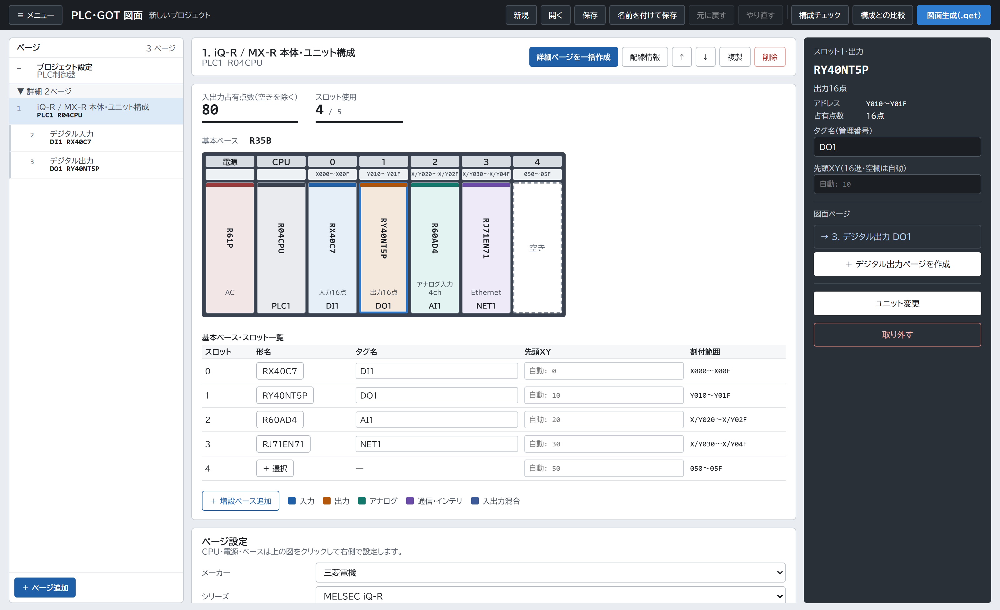
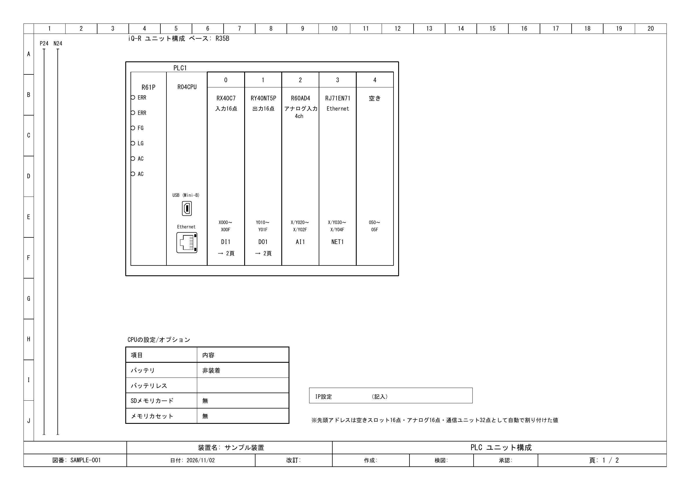
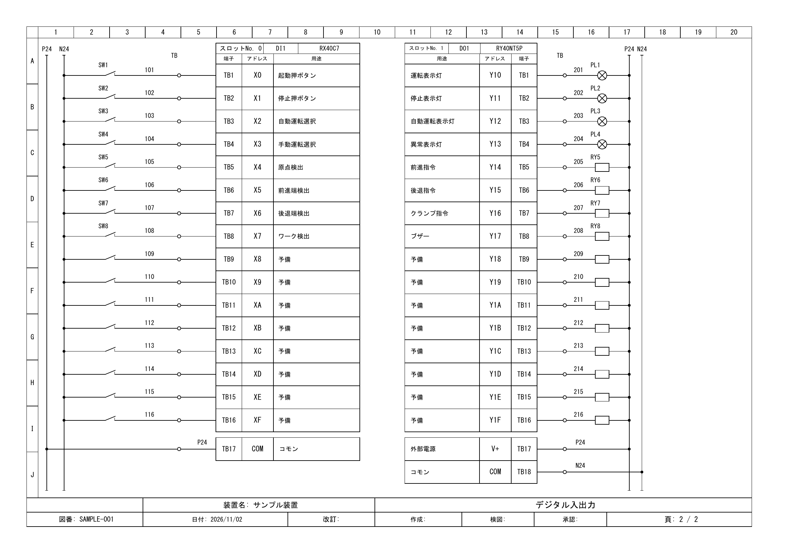

# QET制御図面ビルダー

PLC・GOTの構成図・配線図をQElectroTech向けに生成します。



機種別定義と入出力表（CSV）から、QElectroTechで編集できるPLC・GOTなどの配線図（`.qet`）を生成します。生成後はQETで開いて配線を仕上げます。

## 必要なもの

- Python 3.11以上（画面は pywebview。`GUI起動.bat` が初回に入れる）
- QElectroTech（図面の編集・確認・PDF書出し）

QElectroTechは [配布ページ](https://qelectrotech.github.io/qelectrotech-source-mirror/) からNightly Build（開発版）をダウンロードしてください。Windowsでは「Windows Installer.exe」を選びます。

QETは標準の場所へのインストールを推奨します。Windowsでは通常 `C:\Program Files\QElectroTech` です。別の場所にインストールした場合は、標準部品フォルダーを環境変数 `QET_ELEMENTS_DIR` で指定してください。

PDF調整などの追加要件は [使い方](docs/使い方.md) を参照してください。

## はじめ方

キーエンス・オムロンは、メーカー別メニューの「PLC構成」でCPU／カプラを選び、接続位置の「追加」でユニットを組めます。「構成図＋詳細図を生成」を押すと、編集済みの詳細ページを使い、不足分を追加してQETへ出力します。NX502は左Xバスと右NXバスを別々に表示します。接続条件と範囲は[使い方](docs/使い方.md#キーエンスkvオムロンnxの構成)を参照してください。

キーエンスのKV Nano本体・内蔵／拡張I/O・アナログ・温度・通信などのユニット図は、`GUI起動.bat` の「キーエンス KV・VT」の「ユニット単体図」で形名・機能を検索し、「図面を生成（.qet）」で保存します。ユニットNo.とタグは任意です。通信ユニットは対応する通信方式やIP設定を指定できます。[対応範囲と追加資料](docs/キーエンスKV.md)

オムロンのNXユニット図は、同じメニューの「オムロン NX・NA」の「ユニット単体図」で形名・機能を検索し、「図面を生成（.qet）」で保存します。ユニットNo.とタグは任意です。[対応形名と作図範囲](docs/オムロンNX.md)

VT3・VT5・NA5の対応範囲と操作は、[タッチパネルの本体接続図](docs/タッチパネル.md) を参照してください。

三菱電機の作図手順

1. `GUI起動.bat` を起動し、メニューで「三菱電機 PLC・GOT」を選ぶ。
2. ページを追加し、メーカー → シリーズ → 図面の種類 → 形名の順に選ぶ。本体ページはベースの図でスロットを選んでユニットを追加する。
3. プロジェクトを保存して「図面生成」を押し、出力QETをQElectroTechで開く。

コマンドでの生成:

```console
python gen_io_page.py project.json 出力.qet
```

再生成するとQETで手直しした内容は上書きされます。入力形式・詳細操作は下記資料を参照してください。

リレー・スイッチなどは「制御部品の書出し・ユーザーコレクション登録」から「QETに登録」または「全部QETに登録」でユーザーコレクションへ追加できます。登録先はQETの設定を読み取ります。詳しくは [部品の登録・書出し](docs/使い方.md#部品を書き出す) を参照してください。

## PDF出力例

生成したQETをQElectroTechでPDFに書き出した例です。

### PLC構成図

iQ-Rのベースに入力・出力・アナログ・通信ユニットを搭載し、形名・タグ・アドレス割付を表示します。



### IO図（入出力図）

CSVの信号名・機器番号・線番を使い、入力接点や出力負荷と、端子・アドレス・用途の対応を図面にします。



## 資料

| 資料 | 内容 |
|---|---|
| [使い方](docs/使い方.md) | GUI、部品書出し、参照表更新、サンプル、PDF |
| [設定ファイル](docs/設定ファイル.md) | JSON・CSV、ページ種類、タグ、配線情報・端子台接続図 |
| [開発・保守](docs/開発・保守.md) | コード配置、機種追加、検証、資料・生成物の扱い |
| [図面の書き方ルール](docs/図面の書き方ルール.md) | 配置・端子・配線・注記の共通ルール |
| [対応機種一覧](units_supported.csv) | Excel用CSV。個別の確認状態は `parts/` の対応一覧を参照 |
| [CHANGELOG](CHANGELOG.md) | 変更・検証の履歴 |
| [TODO](TODO.md) | 残件・未確認事項 |

保存済みサンプルは [Sample_qet/](Sample_qet/) にあります。PDF・メーカー資料はGit対象外です。

## ライセンス

自作のコード・文書・部品定義は [MIT License](LICENSE) で公開しています。Copyright (c) 2026 fa-yoshinobu。

このGitHubリポジトリは、自作アプリのソースコードを公開するものです。QET標準コレクションは同梱せず、利用者がインストールしたQElectroTechから読み込みます。

| 利用・配布するもの | できること・守ること |
|---|---|
| このアプリ | 商用を含め、無料で利用・改造・再配布できます。ソースコードやアプリを再配布する場合は、MITの著作権表示とライセンス文を残してください。 |
| このアプリで作った図面（QET・PDFなど） | 自社名を入れて納品・販売できます。図面や入力データをMITで公開する義務はありません。READMEの図面例も、この「図面内での記号利用」に当たります。 |
| QET標準記号を使って書き出した部品（`.elmt`） | 自分の図面で使用できます。部品単体や部品集として他者に配布する場合は、元の作者・出典・ライセンスを残し、変更した内容を明示して、元の再配布条件に従ってください。 |

QElectroTech標準記号とその派生部分には、元の利用条件が適用されます。出典・作者・再配布条件は [外部記号のライセンス](THIRD_PARTY_NOTICES.md) を参照してください。

アプリは無保証です。ライセンスは、生成図面の正しさや実機への適合を保証するものではありません。
